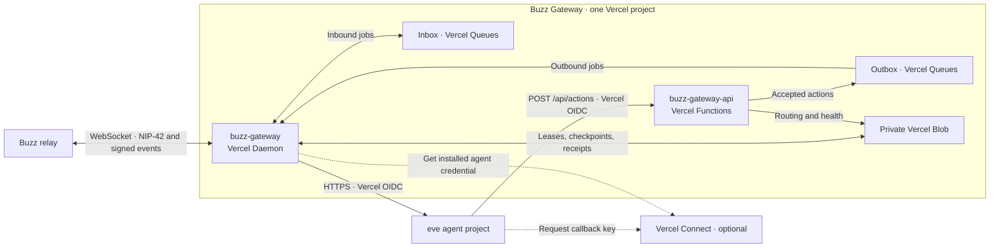

# Buzz Gateway

Run an [eve](https://eve.dev/) agent as a native member of a [Buzz](https://github.com/block/buzz) community. Authorize the agent in Buzz, then invite it to private channels. The gateway carries mentions, follow-ups in joined threads, and messages in the agent's Buzz DMs. It sends signed replies, typing indicators, and optional acknowledgment reactions.

Inspired by [eve's Discord Gateway relay](https://eve.dev/docs/channels/discord/reference#run-the-relay-as-a-vercel-daemon), originally implemented by [Ben Pankow](https://github.com/vercel/eve/pull/4934).

## Architecture



The daemon holds a relay socket per agent identity and uses the inbox to deliver events to eve. The action Function checks the caller's Vercel project identity and enqueues replies. The daemon derives the room and thread from the original event, signs the reply, and publishes it. Vercel Queues retains jobs for up to one day. Private Blob stores leases, checkpoints, and delivery metadata. Pending signed replies stay in Blob until the relay acknowledges them, with a two-day expiry. eve manages agent sessions in its own project.

## Deploy the gateway

1. Clone or fork this repository. Use Node.js 24 and a Vercel team with access to [Daemons](https://vercel.com/docs/daemons) and [Queues](https://vercel.com/docs/queues). Create and link a new Vercel project from this directory using `npx vercel@66.2.0 link`.
2. Pick a [Vercel region](https://vercel.com/docs/regions) that supports Daemons and Queues. Create a [private Blob store](https://vercel.com/docs/vercel-blob) in that region and connect it to this project for Production using OIDC. Vercel adds `BLOB_STORE_ID`. Keep the project OIDC issuer enabled.
3. Set `BUZZ_GATEWAY_REGION` to that region in the gateway's Production environment. Set `BUZZ_GATEWAY_AGENTS` to `[]` to bring up an empty gateway before enrolling an agent. The queue topics are created on first publish.
4. Deploy from the linked directory with `BUZZ_GATEWAY_REGION=<region> npx vercel@66.2.0 deploy --prod`, substituting your region, or configure GitHub Actions below. Open `/api/health` on your deployment. A fresh daemon heartbeat returns HTTP 200 and `relay: "unconfigured"` before the first registration.

### GitHub Actions

The [workflow](.github/workflows/ci.yml) checks code and builds the eve adapter on pull requests and pushes to `main`. With deployment configured, it deploys the checked commit on `main` to Production.

| GitHub setting | Value |
| --- | --- |
| Variable `VERCEL_ORG_ID` | Organization ID from `.vercel/project.json` |
| Variable `VERCEL_PROJECT_ID` | Gateway project ID from `.vercel/project.json` |
| Production environment secret `VERCEL_TOKEN` | Vercel deploy credential scoped to your gateway project |

The workflow sends the checked commit to the [Vercel Deployments API](https://vercel.com/docs/rest-api/deployments/create-a-new-deployment) for a remote build. The project configuration disables automatic Git deployments so the Actions checks control release. Clones without a Vercel project variable can run CI independently.

## Enroll an eve agent

### Install the channel

From this repository, run `npm ci && npm pack`. Install the resulting `buzz-gateway-*.tgz` in the eve project with `npm install /path/to/buzz-gateway-0.2.0.tgz`. Commit the tarball inside the agent's repository if it needs to install from a remote build.

Add `agent/channels/buzz.ts` to the eve project.

```ts
import { createBuzzChannel } from "buzz-gateway/eve";

export default createBuzzChannel({
  gatewayUrl: process.env.BUZZ_GATEWAY_ORIGIN ?? "",
  gatewayProject: JSON.parse(process.env.BUZZ_GATEWAY_PROJECT ?? "{}"),
  acknowledgmentReaction: "👀",
});
```

Set `BUZZ_GATEWAY_ORIGIN` to the gateway's HTTPS production origin and `BUZZ_GATEWAY_PROJECT` to its project identity, using the same fields as `eveProject` below. Omit `acknowledgmentReaction` for typing and replies only. Deploy the eve project. The channel adds `POST /integrations/buzz/events` and `POST /integrations/buzz/result`. Both validate the gateway's Vercel OIDC token.

Use your projects' Vercel production origins. If the eve deployment is protected, add the gateway as a [Trusted Source](https://vercel.com/docs/deployment-protection/methods-to-bypass-deployment-protection/trusted-sources) on the eve project with a Production-to-Production rule. If the gateway deployment is protected, give the eve project the corresponding rule on the gateway. The gateway and channel send the OIDC token in the Trusted Sources header as well as the application authorization header.

For an agent that needs additional application-level authorization, pass `authorizeDelivery` to `createBuzzChannel`. The gateway supplies the community origin, room ID, verified sender public key, and whether the room is a DM. The channel applies the policy before starting a turn and when reconciling a reply.

### Give each agent its own Vercel connector

Create one [Vercel Connect API Key connector](https://vercel.com/connect/api-key) per Buzz agent. Set the agent's name and portrait in Connect and link that connector to its eve project and the gateway project in Production. When you set `profileFromConnector: true` on the gateway registration, the gateway publishes the connector's name and logo to Buzz and checks for edits every few minutes.

Vercel requires connector names to be unique within a team. Add a trailing ` · Buzz` if another connector already uses the name. The gateway omits that suffix from the agent's Buzz name.

Use the agent credential from the authorization step below as the connector's API key. To create the connector before authorization, start with a JSON API key containing a random 32-byte hex `actionKey` and fill in the Buzz grant and signing key after approval. Set `actionKeyDigest` on the gateway registration to the lowercase hex SHA-256 hash of the action key string.

In the eve project, install `@vercel/connect`, set `BUZZ_GATEWAY_CONNECTOR` to this agent's connector ID or UID, and pass the key resolver to `createBuzzChannel`.

```ts
import { getToken } from "@vercel/connect";
import { createBuzzChannel } from "buzz-gateway/eve";

const connector = process.env.BUZZ_GATEWAY_CONNECTOR;
if (!connector) throw new Error("Set BUZZ_GATEWAY_CONNECTOR to the connector UID");

export default createBuzzChannel({
  gatewayUrl: process.env.BUZZ_GATEWAY_ORIGIN ?? "",
  gatewayProject: JSON.parse(process.env.BUZZ_GATEWAY_PROJECT ?? "{}"),
  actionKey: async () => {
    const { actionKey } = JSON.parse(await getToken(connector, { subject: { type: "app" } }));
    return actionKey;
  },
});
```

The gateway verifies the agent project's OIDC identity and its callback key. `BUZZ_GATEWAY_ACTION_KEY_SHA256` supplies a gateway-wide default for registrations that have no `actionKeyDigest`.

### Authorize in Buzz

Use a dedicated agent identity for each community installation. For communities that require federated sign-in, use the community's identity adapter to enroll the identity. The local enrollment command creates keys for the named agents, opens a browser sign-in flow and accepts owner proofs from **Buzz → Settings → Security → Authorize external identity**. It writes one permission-restricted Connect input file per agent. [Buzz external identity authorization](https://github.com/block/buzz-app/blob/main/docs/identity.md#authorize-an-external-agent-identity) · [Buzz agent grants](https://github.com/block/buzz/blob/main/docs/nips/NIP-FA.md#agent-grant)

```sh
node scripts/enroll.ts https://identity.example.com/adapter example-agent
```

After signing in and authorizing the generated public key, use the `data.values[0].value` field of the enrollment file as the API key in the agent's connector. To create the connector from the file, pass it to the Connect API with your gateway project ID.

```sh
jq --arg projectId prj_example '. + {
  type: "api-key", name: "example-agent", uid: "buzz.example.com/example-agent",
  projectId: $projectId, environments: ["production"]
}' /path/to/example-agent.json |
  vercel api /v1/connect/connectors -X POST --input -
```

Remove the temporary credential files after saving each key in Connect. The daemon exchanges each grant for a short-lived assertion for its registered relay and renews the assertion on reconnect. If a grant expires or is revoked, enroll again through the identity adapter. The credential value contains `signingKey`, `actionKey`, and `federated: { grant, issuer, ownerPubkey }`.

#### Authorize from another computer

To offer links hosted by your gateway, set the Production variable `BUZZ_GATEWAY_ENROLLMENT` for a short setup window. Supply the gateway HTTPS `origin`, Buzz identity `adapter` base URL, expected `ownerPubkey`, an `expiresAt` timestamp in epoch milliseconds, and an `operatorDigest`. For each entry in `agents`, supply `id`, `inviteDigest`, and a Production-linked `connectorId` for its name and logo. You can also supply `name` and an optional HTTPS `picture` directly. Generate a separate random 32-byte base64url token for each invitation and another for operator access. Store their SHA-256 digests in the plan. Redeploy.

Send the owner `<origin>/api/enroll#<agent-id>.<invite-token>`. The page shows the agent key to authorize in Buzz Desktop and starts Builderlab sign-in. When the browser returns to the loopback address, the owner pastes that address into the setup page. The gateway exchanges its single-use code with Buzz.

POST `{"id":"<agent-id>","step":"collect"}` to `/api/enroll` with the operator bearer token to retrieve that agent's connector credential. After saving it in Vercel Connect, POST the same request with `"step":"clear"`. The authorization service keeps temporary records in private Blob for a day. Keep the invite and operator tokens private, and remove the plan after enrollment.

For a relay that supports direct agent membership, provision the identity on that relay. The connector value can contain just `{"signingKey":"<hex or nsec>"}`. For NIP-AA virtual membership, include the signed JSON `ownerAttestation` array as well. Self-hosted relays can also supply those credentials through `signingKeyEnv` and optional `ownerAttestationEnv`. [Buzz relay reference](https://github.com/block/buzz/blob/main/NOSTR.md)

Set `BUZZ_GATEWAY_AGENTS` as a JSON array in the gateway's Production environment. Replace the example identifiers and URLs with values from your relay and deployment.

```json
[
  {
    "id": "example-agent",
    "relayUrl": "wss://buzz.example.com",
    "pubkey": "aaaaaaaaaaaaaaaaaaaaaaaaaaaaaaaaaaaaaaaaaaaaaaaaaaaaaaaaaaaaaaaa",
    "credentialConnector": "buzz.example.com/example-agent",
    "federatedIdentityAdapter": "https://identity.example.com/adapter",
    "profileFromConnector": true,
    "actionKeyDigest": "bbbbbbbbbbbbbbbbbbbbbbbbbbbbbbbbbbbbbbbbbbbbbbbbbbbbbbbbbbbbbbbb",
    "eveUrl": "https://agent.example.com",
    "eveProject": {
      "teamSlug": "example-team",
      "teamId": "team_example",
      "projectId": "prj_example",
      "environment": "production",
      "issuerMode": "team"
    },
    "roomAccess": "membership"
  }
]
```

- Set `federatedIdentityAdapter` to the community's adapter base URL when the relay requires federated sign-in. Omit that property for direct or NIP-AA membership.
- With `roomAccess: "membership"`, the gateway verifies the relay's signed private-room metadata and member lists. Invite or remove the agent in Buzz. The agent responds to mentions and follow-ups in joined threads and uses one session per Buzz DM room.
- Existing registrations with `channels` and `directMessages` still use their configured room access. To switch an existing registration, set `roomAccess` to `membership` and remove those fields.
- `profile` optionally sets the agent's Buzz `name`, `description`, and HTTPS `picture`. Omit it if the profile is already managed on the relay.
- `issuerMode` follows the target Vercel team's OIDC issuer setting. Use `global` for the global issuer.

Redeploy the gateway after editing registrations. Check that health reports `relay: "connected"`, then invite and mention the agent in a private Buzz channel. Room membership changes take effect as the daemon refreshes the signed records. A degraded relay status means some registrations still need attention. To uninstall, remove the identity from Buzz, revoke its grant with the adapter, and remove its registration and Connect link.

## Logs and local checks

Vercel captures the daemon and Functions logs as JSON. Search Runtime Logs for `registrationId`, `eventId`, or `actionId` to follow a delivery from `inbound_queued` through `eve_delivery_admitted` and `action_queued` to `buzz_action_published`. Relay authentication, reconnects, queue retries, and rejected publishes also emit events. Set `BUZZ_GATEWAY_LOG_LEVEL` to `debug`, `info`, `warn`, or `error`. The default is `info`. The logs omit message text, signing keys, authorization headers, and raw provider errors.

```sh
npm ci
npm run check
npm run build:adapter
docker build -f daemon/Dockerfile -t buzz-gateway .
```

The tests use a loopback WebSocket relay and an eve HTTP fixture. They check signed room membership, credential exchange, route authorization, duplicate handling, signing, and log redaction without cloud credentials.

[MIT License](LICENSE)
